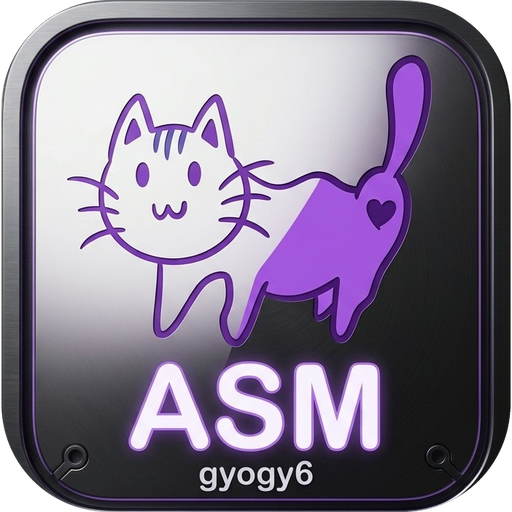
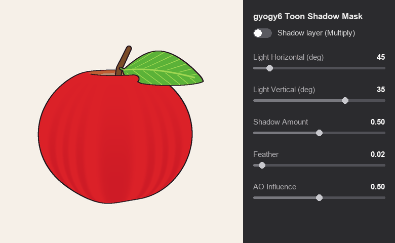
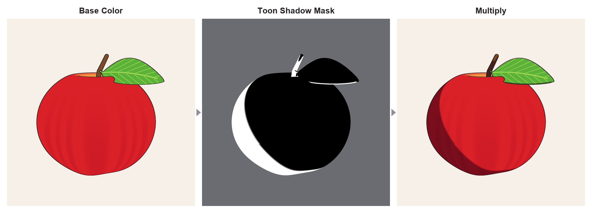
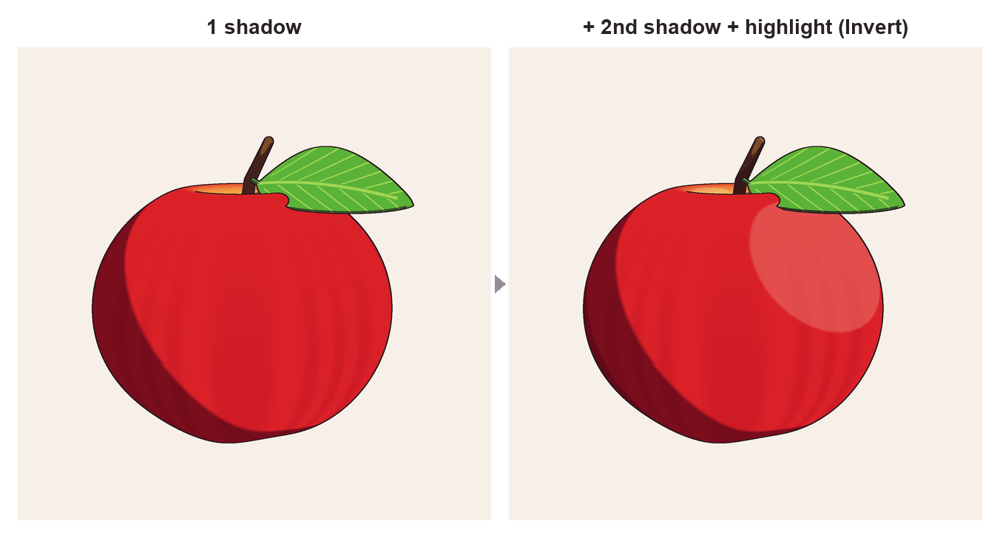

# gyogy6 Toon Shadow Mask (무료판)

[English](README.md) / [日本語](README.ja.md) / [简体中文](README.zh-CN.md) / **한국어**

Substance 3D Painter용 제너레이터입니다.
빛의 방향을 지정하면 애니메이션풍(셀 셰이딩풍)의 선명한 그림자 영역을 흑백 마스크로 만들어 줍니다.
레이어 마스크에 넣기만 하면 사용할 수 있습니다.

- 버전: 1.0.0
- 가격: 무료 (상업적 이용 가능, 크레디트 선택)
- 이용약관: [LICENSE.md](LICENSE.md) (**다운로드 또는 사용한 시점에 약관에 동의한 것으로 간주합니다**)

---

## 완성 이미지

왼쪽부터 '베이스 컬러만', '이 제너레이터가 만드는 흑백 마스크(흰색이 그림자)', '마스크를 적용한 그림자 레이어를 곱하기(Multiply)로 겹친 결과'입니다.

> **※ 이미지는 참고용입니다.** Substance 3D Painter의 실제 화면이나 출력이 아니라, 이 설명서에 적힌 파라미터의 동작을 재현해 만든 설명용 이미지입니다. 실제 결과는 모델, 베이크 결과, 설정에 따라 달라집니다. 오른쪽의 조작 패널과 모델의 검은 윤곽선도 설명을 위해 그린 것으로, 이 제너레이터의 기능이 아닙니다.

---

## 1. 포함 파일

| 파일 | 내용 |
|---|---|
| `gyogy6_toon_shadow_mask.sbsar` | 제너레이터 본체 |
| `docs/icon.png` | 설명서용 아이콘 이미지 (.sbsar에도 같은 아이콘이 들어 있습니다) |
| `docs/demo.gif`, `docs/breakdown.png`, `docs/layers.png` | 설명용 참고 이미지 |
| `README.md` 외 | 이 설명서 (영어, 일본어, 중국어, 한국어) |
| `LICENSE.md` | 이용약관 |

## 2. 동작 환경

- Adobe Substance 3D Painter
- 그림자를 넣을 모델에 **UV가 펼쳐져 있을 것**

## 3. 설치

1. Painter 상단 메뉴에서 **File → Import resources**를 엽니다.
2. **Add resources**를 눌러 `gyogy6_toon_shadow_mask.sbsar`를 선택합니다.
3. 목록에 추가된 파일의 종류를 **generator**로 설정합니다.
4. 가져올 위치를 선택합니다.
   - 현재 프로젝트에서만 사용할 경우: **Current session** 또는 **Project**
   - 모든 프로젝트에서 사용할 경우: 자신의 라이브러리
5. **Import**를 누릅니다.
6. 에셋 셸프의 **Generators**에 이 페이지 상단과 같은 아이콘의 **gyogy6 Toon Shadow Mask**가 표시되면 완료입니다.

## 4. 사전 준비: 메시 맵 베이크 (프로젝트마다 1회)

이 제너레이터는 Painter가 베이크한 메시 맵을 사용하여 그림자를 만듭니다.

1. **Texture Set Settings** 패널에서 **Bake Mesh Maps**를 누릅니다.
2. 다음 두 항목이 체크되어 있는지 확인합니다.
   - **World space normal** (빛의 방향 계산에 사용, **필수**)
   - **Ambient occlusion** (오목한 부분을 그림자로 만드는 데 사용)
3. **Bake selected textures**를 누르고 베이크가 끝날 때까지 기다립니다.

## 5. 사용법

### 5-1. 그림자 레이어 만들기

1. 레이어 패널에서 **Add fill layer**를 누릅니다.
2. 만든 레이어에서 **Base Color 이외의 채널을 모두 끕니다**.
3. **Base Color**에 그림자 색을 설정합니다.
   회색보다 약간 색감이 있는 색(피부는 붉은 기, 옷은 청보라 계열 등)이 탁하지 않은 애니메이션다운 그림자가 됩니다.
4. 블렌드 모드를 **Multiply**(곱하기)로 설정합니다.

### 5-2. 마스크에 제너레이터 넣기

1. 레이어를 우클릭하고 **Add black mask**를 선택합니다.
2. 마스크를 우클릭하고 **Add generator**를 선택합니다.
3. 제너레이터 선택란에서 **gyogy6 Toon Shadow Mask**를 선택합니다.
4. 그림자 부분에만 색이 올라가면 성공입니다.

### 5-3. 파라미터

| 항목 | 의미 | 기준 |
|---|---|---|
| **Light Horizontal (deg)** | 빛이 들어오는 방향 (0–360°). 0은 모델 정면입니다. | 30–60 |
| **Light Vertical (deg)** | 빛의 높이 (-89–89°). 클수록 위에서 비춥니다. | 20–50 |
| **Shadow Amount** | 그림자의 넓이. 올리면 그림자가 넓어집니다. | 0.4–0.6 |
| **Feather** | 그림자 경계의 흐림 폭. 작을수록 선명해집니다. | 0.01–0.05 |
| **AO Influence** | 오목한 부분(겨드랑이, 목 아래, 옷이 겹치는 부분 등)을 항상 그림자로 만드는 강도. | 0.3–0.8 |
| **Invert (lit side)** | 1로 하면 그림자 대신 빛을 받는 쪽이 흰색이 됩니다. 하이라이트용입니다. | 0 |

### 5-4. 팁

- **진한 그림자(2단 그림자) 추가:** 같은 방법으로 레이어를 하나 더 만들고 **Shadow Amount를 작게(0.1–0.3)** 설정합니다.
- **손으로 수정:** 마스크 안에서 제너레이터 위에 **Paint**를 추가하고, 흰색(그림자 추가)이나 검은색(그림자 제거)으로 그립니다.
- **하이라이트:** **Invert**를 1로 한 레이어를 만들고 블렌드 모드를 **Screen**으로 설정합니다.

왼쪽: 그림자 1장. 오른쪽: 2단 그림자(Shadow Amount 0.22)와 하이라이트(Invert 1, Screen)를 추가한 예입니다. (참고용 이미지)

## 6. 문제 해결

| 증상 | 확인할 사항 |
|---|---|
| 목록에 gyogy6 Toon Shadow Mask가 나오지 않음 | 가져올 때 종류를 **generator**로 설정했는지 확인하세요. 다른 종류로 가져온 경우 삭제한 뒤 다시 가져오세요. |
| 전체가 검게 되거나 아무것도 나오지 않음 | 메시 맵 베이크(4장)가 끝났는지 확인하세요. **World space normal**이 필수입니다. |
| 빛의 방향이 예상과 다름 | Light Horizontal / Light Vertical을 조정하세요. |

## 7. 이용약관 요점

전체 약관은 [LICENSE.md](LICENSE.md)를 읽어 주십시오. 여기서는 요점만 정리합니다.

**할 수 있는 것**
- 개인·법인, 상업적·비상업적 용도를 불문하고 사용
- 이 툴로 만든 텍스처를 사용한 작품(VRChat 아바타, 게임, 일러스트 등)의 판매·배포 (크레디트 선택)

**할 수 없는 것**
- `.sbsar` 파일의 재배포·판매 (무료여도, 수정하지 않았어도 금지)
- `.sbsar`의 수정, 분석, 내용 추출
- **이 제너레이터가 포함된 상태의** Painter 프로젝트(.spp), 스마트 머티리얼, 스마트 마스크, 템플릿의 배포
  → 배포할 때는 **텍스처를 이미지로 내보낸 뒤** 배포해 주십시오.
- AI 학습 데이터로의 이용, NFT로의 발행

다른 사람에게 소개하실 때는 파일이 아니라 배포 페이지의 URL을 공유해 주십시오.

## 8. 문의

버그 보고는 GitHub Issues에서 받고 있습니다 (대응을 약속드릴 수는 없습니다).

---

Adobe 및 Substance 3D Painter는 Adobe의 상표 또는 등록상표입니다. 본 제품은 Adobe와 제휴 관계가 없으며 승인을 받지도 않았습니다.
© 2026 gyogy6
