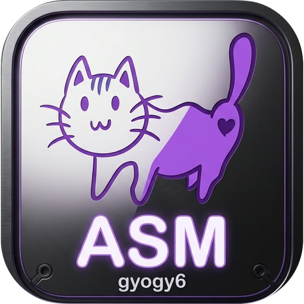
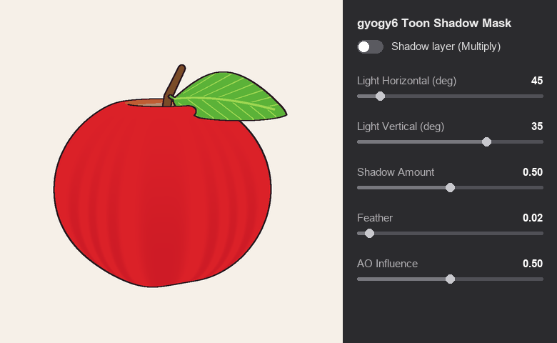
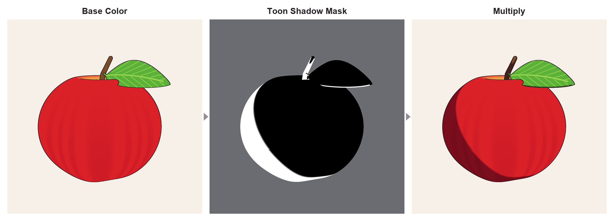
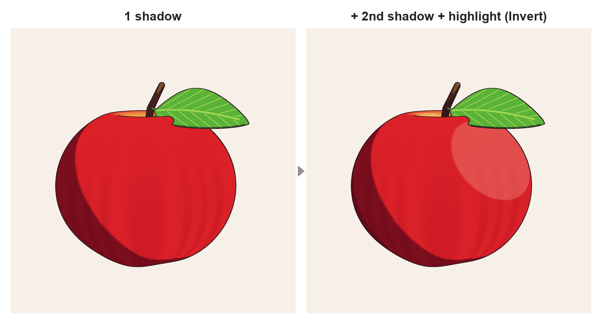

# gyogy6 Toon Shadow Mask（免费版）

[English](README.md) / [日本語](README.ja.md) / **简体中文** / [한국어](README.ko.md)

这是一个用于 Substance 3D Painter 的生成器（Generator）。
只需指定光照方向，即可生成动画风格（赛璐璐风格）的清晰阴影区域，并以黑白遮罩的形式输出。
放入图层遮罩即可使用。

- 版本：1.0.0
- 价格：免费（可商用，署名可选）
- 使用条款：[LICENSE.md](LICENSE.md)（**下载或使用本产品即视为同意本条款**）

---

## 效果示意

从左到右：仅基础颜色、本生成器生成的黑白遮罩（白色为阴影）、使用该遮罩的阴影图层以正片叠底（Multiply）叠加后的结果。

<b>※ 图片仅为示意。</b>

这些图片并非 Substance 3D Painter 的实际界面或输出，而是根据本说明书中参数的效果再现制作的说明用图片。实际效果会因模型、烘焙结果和设置而不同。右侧的操作面板和模型的黑色轮廓线也是为示意而绘制的，并非本生成器的功能。

---

## 1. 包含文件

| 文件 | 内容 |
|---|---|
| `gyogy6_toon_shadow_mask.sbsar` | 生成器本体 |
| `docs/icon.png` | 说明书用图标图像（.sbsar 中也内置了相同的图标） |
| `docs/demo.gif`、`docs/breakdown.png`、`docs/layers.png` | 说明用示意图片 |
| `README.md` 等 | 本说明书（英语、日语、中文、韩语） |
| `LICENSE.md` | 使用条款 |

## 2. 运行环境

- Adobe Substance 3D Painter
- 模型需要**已展开 UV**

## 3. 安装

1. 在 Painter 的菜单中打开 **File → Import resources**。
2. 点击 **Add resources**，选择 `gyogy6_toon_shadow_mask.sbsar`。
3. 将添加的文件类型设为 **generator**。
4. 选择导入位置：
   - 仅在当前项目中使用：**Current session** 或 **Project**
   - 在所有项目中使用：你自己的资源库
5. 点击 **Import**。
6. 资源架（Shelf）的 **Generators** 中出现带有本页顶部同款图标的 **gyogy6 Toon Shadow Mask**，即表示安装完成。

## 4. 准备工作：烘焙网格贴图（每个项目一次）

本生成器使用 Painter 烘焙的网格贴图（Mesh Maps）来生成阴影。

1. 在 **Texture Set Settings** 面板中点击 **Bake Mesh Maps**。
2. 确认以下两项已勾选：
   - **World space normal**（用于计算光照方向，**必需**）
   - **Ambient occlusion**（用于让凹陷处产生阴影）
3. 点击 **Bake selected textures**，等待烘焙完成。

## 5. 使用方法

### 5-1. 创建阴影图层

1. 在图层面板中点击 **Add fill layer**。
2. 在新建的图层中，**关闭 Base Color 以外的所有通道**。
3. 将 **Base Color** 设置为阴影颜色。
   相比灰色，带一点色彩倾向的颜色（皮肤偏红、衣服偏蓝紫等）能得到更通透的动画风格阴影。
4. 将混合模式设为 **Multiply**（正片叠底）。

### 5-2. 在遮罩中添加生成器

1. 右键点击图层，选择 **Add black mask**。
2. 右键点击遮罩，选择 **Add generator**。
3. 在生成器的选择栏中选择 **gyogy6 Toon Shadow Mask**。
4. 如果颜色只出现在阴影部分，即表示成功。

### 5-3. 参数

| 参数 | 含义 | 参考值 |
|---|---|---|
| **Light Horizontal (deg)** | 光从哪个方向照射（0–360°）。0 表示从模型正面照射。 | 30–60 |
| **Light Vertical (deg)** | 光的高度（-89–89°）。数值越大，光越从上方照射。 | 20–50 |
| **Shadow Amount** | 阴影范围。数值越大，阴影越大。 | 0.4–0.6 |
| **Feather** | 阴影边缘的柔和程度。数值越小，边缘越清晰。 | 0.01–0.05 |
| **AO Influence** | 让凹陷处（腋下、颈下、衣服重叠处等）始终处于阴影中的强度。 | 0.3–0.8 |
| **Invert (lit side)** | 设为 1 时，受光面变为白色（而非阴影）。用于高光。 | 0 |

### 5-4. 提示

- **添加更深的第二层阴影：** 按相同步骤再创建一个图层，并将 **Shadow Amount 设得较小（0.1–0.3）**。
- **手动修正：** 在遮罩中于生成器上方添加 **Paint**，用白色（增加阴影）或黑色（去除阴影）绘制。
- **高光：** 创建一个 **Invert** 设为 1 的图层，并将混合模式设为 **Screen**（滤色）。

左：一层阴影。右：添加了第二层阴影（Shadow Amount 0.22）和高光（Invert 1、Screen）。（图片仅为示意）

## 6. 常见问题

| 现象 | 检查事项 |
|---|---|
| 列表中没有 gyogy6 Toon Shadow Mask | 请确认导入时类型设为了 **generator**。如果以其他类型导入，请删除后重新导入。 |
| 全黑或没有任何显示 | 请确认网格贴图已烘焙完成（第 4 节）。**World space normal** 是必需的。 |
| 光照方向与预期不同 | 请调整 Light Horizontal / Light Vertical。 |

## 7. 使用条款要点

完整条款请阅读 [LICENSE.md](LICENSE.md)。以下仅为摘要。

**可以**
- 个人或企业均可使用，商业及非商业用途均可
- 销售或发布使用本工具制作的纹理所完成的作品（VRChat 虚拟形象、游戏、插画等），署名可选

**不可以**
- 再发布或销售 `.sbsar` 文件（即使免费、即使未修改也不可以）
- 修改、分析或提取 `.sbsar` 的内容
- 发布**仍包含本生成器的** Painter 项目文件（.spp）、智能材质、智能遮罩或模板
  → 发布前请先**将纹理导出为图像**。
- 用作 AI 训练数据，或作为 NFT 发行

如需向他人介绍本产品，请分享下载页面的 URL，而不是文件本身。

## 8. 联系方式

欢迎通过 GitHub Issues 报告缺陷（不保证回复）。

---

Adobe 和 Substance 3D Painter 是 Adobe 的商标或注册商标。本产品与 Adobe 无合作关系，也未获得其认可。
© 2026 gyogy6
